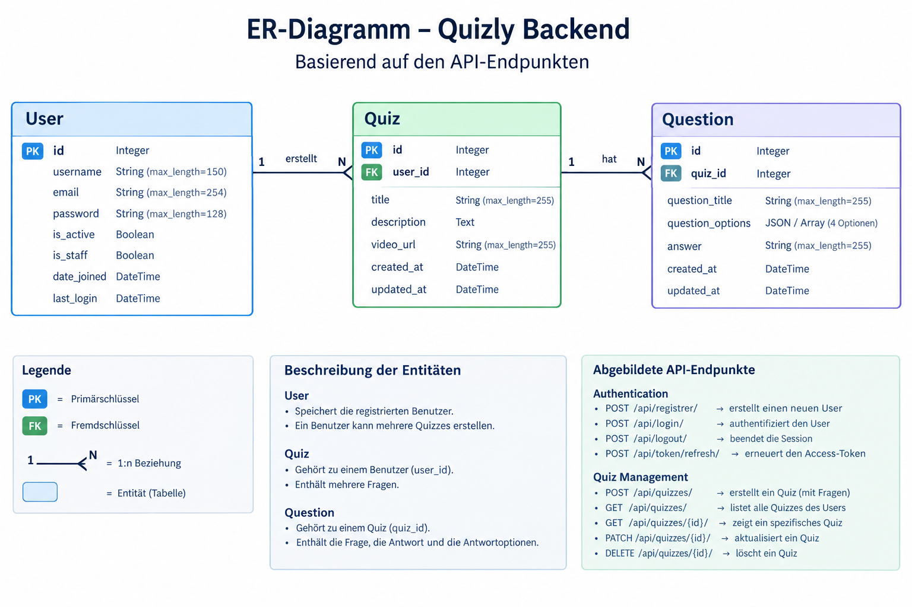

# Quizly Backend

The Django REST API for **Quizly** – an application that allows users to automatically generate interactive multiple-choice quizzes from YouTube videos.

The backend manages user accounts, authentication, quizzes, and questions. Quiz generation is based on video content transcription followed by processing with an AI model.

**Project Status:** Under development. The core functionality for user management, authentication, and quiz management has been implemented and tested. YouTube video processing and integration with external AI services require the appropriate system dependencies and API credentials.

## Table of Contents

- [Features](#features)
- [Technologies](#technologies)
- [Project Structure](#project-structure)
- [Architecture and Database Model](#architecture-and-database-model)
- [API Documentation](#api-documentation)
- [Installation and Setup](#installation-and-setup)
- [Environment Variables](#environment-variables)
- [Tests](#tests)
- [Security](#security)
- [Error Handling](#error-handling)
- [Development Workflow](#development-workflow)
- [Git Commit Conventions](#git-commit-conventions)
- [License and Usage](#license-and-usage)

---

## Features

The backend provides the following functionality:

- User registration and login
- Authentication using access and refresh tokens stored in HTTP cookies
- Logout with refresh token invalidation
- Refreshing expired access tokens
- Creating quizzes from YouTube URLs
- Processing YouTube videos and transcripts
- Audio transcription using OpenAI Whisper
- Generating quiz questions using the Google Gemini API
- Creating multiple-choice questions with four answer options each
- Listing, retrieving, updating, and deleting the user's own quizzes
- Automated tests using Django and pytest

## Technologies

| Technology | Purpose |
|---|---|
| Python | Programming language |
| Django | Backend framework |
| Django REST Framework | REST API |
| djangorestframework-simplejwt | JWT authentication |
| django-cors-headers | CORS configuration |
| SQLite | Local development and test database |
| yt-dlp | Retrieving YouTube content |
| FFmpeg | Audio processing and conversion |
| OpenAI Whisper | Transcribing audio into text |
| Google Gemini API | Generating quiz questions |
| google-genai | Python SDK for Gemini |
| python-dotenv | Loading environment variables |
| pytest | Testing framework |
| pytest-django | Django integration for pytest |
| Coverage.py | Measuring test coverage |

## Project Structure

The following structure represents the current backend repository. Automatically generated files and directories, such as `__pycache__`, `.pytest_cache`, and the virtual environment, are not included.

```text
Quizly-Backend/
│
├── core/
│   ├── __init__.py
│   ├── settings.py
│   ├── test_settings.py
│   ├── urls.py
│   ├── asgi.py
│   └── wsgi.py
│
├── users/
│   ├── api/
│   │   ├── __init__.py
│   │   ├── authentication.py
│   │   ├── serializers.py
│   │   └── views.py
│   ├── migrations/
│   │   └── __init__.py
│   ├── services/
│   │   ├── __init__.py
│   │   ├── authentication.py
│   │   ├── registration.py
│   │   └── tokens.py
│   ├── tests/
│   │   ├── __init__.py
│   │   ├── test_functions.py
│   │   ├── test_login.py
│   │   ├── test_logout.py
│   │   ├── test_register.py
│   │   └── test_token_refresh.py
│   ├── __init__.py
│   ├── admin.py
│   ├── apps.py
│   └── models.py
│
├── quizzes/
│   ├── api/
│   │   ├── __init__.py
│   │   ├── serializers.py
│   │   └── views.py
│   ├── migrations/
│   │   ├── __init__.py
│   │   ├── 0001_initial.py
│   │   └── 0002_question.py
│   ├── services/
│   │   ├── __init__.py
│   │   ├── audio.py
│   │   ├── gemini.py
│   │   ├── quiz_generation.py
│   │   ├── transcripts.py
│   │   └── validation.py
│   ├── tests/
│   │   ├── __init__.py
│   │   ├── test_create_quiz.py
│   │   ├── test_delete_quiz.py
│   │   ├── test_functions_gemini.py
│   │   ├── test_functions_transcripts.py
│   │   ├── test_functions_validation.py
│   │   ├── test_functions_whisper.py
│   │   ├── test_get_quiz.py
│   │   ├── test_list_quizzes.py
│   │   ├── test_models.py
│   │   └── test_update_quiz.py
│   ├── __init__.py
│   ├── admin.py
│   ├── apps.py
│   └── models.py
│
├── docs/
│   └── er-diagram.png
│
├── .env.example
├── .gitignore
├── manage.py
├── pytest.ini
├── requirements.txt
└── README.md
```

The API routes are defined centrally in `core/urls.py`.

Quiz generation and its supporting functionality are organized in the `quizzes/services/` package.

User authentication and registration functionality are organized in the `users/services/` package.

## Architecture and Database Model

The database consists of three central entities:

- `User`
- `Quiz`
- `Question`

### User

The project uses Django's built-in User model.

Important fields:

| Field | Description |
|---|---|
| `id` | Primary key |
| `username` | Unique username |
| `email` | Email address |
| `password` | Hashed password |
| `is_active` | Indicates whether the account is active |
| `is_staff` | Determines access to the Django administration area |
| `date_joined` | Account creation date |
| `last_login` | Last login date |

Passwords are never stored in plain text. Django's authentication system handles password hashing.

### Quiz

Each quiz belongs to exactly one user. A user can own multiple quizzes.

| Field | Description |
|---|---|
| `id` | Primary key |
| `user_id` | Foreign key referencing the owner |
| `title` | Quiz title |
| `description` | Quiz description |
| `video_url` | Original YouTube URL |
| `created_at` | Creation timestamp |
| `updated_at` | Last modification timestamp |

### Question

Each question belongs to exactly one quiz. A quiz can contain multiple questions.

| Field | Description |
|---|---|
| `id` | Primary key |
| `quiz_id` | Foreign key referencing the quiz |
| `question_title` | Question text |
| `question_options` | Answer options stored as a JSON array |
| `answer` | Correct answer |
| `created_at` | Creation timestamp |
| `updated_at` | Last modification timestamp |

Each generated question is expected to have exactly four different answer options. The correct answer must match one of these options.

### Relationships

The database relationships are:

- `User 1:n Quiz`
- `Quiz 1:n Question`

When a quiz is deleted, its associated questions are deleted as well. The deletion behavior for users and their quizzes is determined by the Django model relationships.

### Entity Relationship Diagram

The following diagram illustrates the database structure and the relationships between the models.



## API Documentation

**Base URL for local development:**

```text
http://127.0.0.1:8000
```

The API uses JSON for request and response bodies unless stated otherwise.

### Endpoint Overview

| Method | Endpoint | Description | Authentication |
|---|---|---|---|
| POST | `/api/register/` | Register a user | No |
| POST | `/api/login/` | Log in a user | No |
| POST | `/api/logout/` | Log out a user | Yes |
| POST | `/api/token/refresh/` | Refresh the access token | Refresh cookie |
| POST | `/api/quizzes/` | Create a quiz | Yes |
| GET | `/api/quizzes/` | List own quizzes | Yes |
| GET | `/api/quizzes/{id}/` | Retrieve a quiz | Yes |
| PATCH | `/api/quizzes/{id}/` | Update a quiz | Yes |
| DELETE | `/api/quizzes/{id}/` | Delete a quiz | Yes |

### Authentication

#### 1. Register a User

`POST /api/register/`

Registers a new user. Authentication is not required.

**Request:**

```json
{
  "username": "your_username",
  "password": "your_password",
  "confirmed_password": "your_password",
  "email": "your_email@example.com"
}
```

**Successful response: `201 Created`**

```json
{
  "detail": "User created successfully!"
}
```

Possible errors:

- `400 Bad Request` – Invalid input, username already in use, or passwords do not match.

#### 2. Log In

`POST /api/login/`

Authenticates a user using their username and password.

**Request:**

```json
{
  "username": "your_username",
  "password": "your_password"
}
```

**Successful response: `200 OK`**

```json
{
  "detail": "Login successfully!",
  "user": {
    "id": 1,
    "username": "your_username",
    "email": "your_email@example.com"
  }
}
```

After successful authentication, the server sets the following cookies:

- `access_token` – Used for authenticated API requests.
- `refresh_token` – Used to obtain a new access token.

The cookies are configured with security options such as `HttpOnly`, an appropriate `SameSite` setting, and `Secure` for HTTPS environments.

Possible errors:

- `400 Bad Request` – Missing or invalid input data.
- `401 Unauthorized` – Invalid login credentials.

#### 3. Log Out

`POST /api/logout/`

Ends an authenticated session, deletes the token cookies, and invalidates the refresh token.

**Request body:**

```json
{}
```

**Successful response: `200 OK`**

```json
{
  "detail": "Log-Out successfully! All Tokens will be deleted. Refresh token is now invalid."
}
```

Possible errors:

- `401 Unauthorized` – Missing valid authentication or no usable refresh token.

#### 4. Refresh the Access Token

`POST /api/token/refresh/`

Refreshes the access token using a valid `refresh_token` cookie.

**Request body:**

```json
{}
```

The refresh token is read from the cookie.

**Successful response: `200 OK`**

```json
{
  "detail": "Token refreshed"
}
```

The server sets a new `access_token` cookie.

Possible errors:

- `401 Unauthorized` – Missing, invalid, or expired refresh token.

### Quiz Management

All quiz endpoints require valid authentication. Users can only access their own quizzes.

#### 5. Create a Quiz

`POST /api/quizzes/`

Automatically creates a quiz from a YouTube video.

**Request:**

```json
{
  "url": "https://www.youtube.com/watch?v=example"
}
```

**Processing workflow:**

1. Validate the URL and extract the YouTube video ID.
2. Normalize the URL into a consistent format.
3. Retrieve the available video or audio data.
4. Process the audio with FFmpeg when necessary.
5. Transcribe the spoken content using Whisper.
6. Send the transcript to Gemini.
7. Generate multiple-choice questions with four answer options each.
8. Parse and validate the AI-generated response.
9. Save the quiz and its questions in the database.
10. Remove temporary files after processing.

**Successful response: `201 Created`**

```json
{
  "id": 1,
  "title": "Introduction to the Topic",
  "description": "An overview of the main topics covered in the video.",
  "created_at": "2026-01-15T10:00:00Z",
  "updated_at": "2026-01-15T10:00:00Z",
  "video_url": "https://www.youtube.com/watch?v=example",
  "questions": [
    {
      "id": 1,
      "question_title": "Which statement about the topic is correct?",
      "question_options": [
        "Answer A",
        "Answer B",
        "Answer C",
        "Answer D"
      ],
      "answer": "Answer B",
      "created_at": "2026-01-15T10:00:00Z",
      "updated_at": "2026-01-15T10:00:00Z"
    }
  ]
}
```

This example illustrates the response structure. The actual number of questions depends on the generation process. IDs and timestamps are generated by the backend.

Possible errors:

- `400 Bad Request` – Invalid or unsupported URL.
- `401 Unauthorized` – Missing or invalid authentication.
- Errors from external services during video processing, transcription, or AI generation.

#### 6. List Own Quizzes

`GET /api/quizzes/`

Returns the quizzes belonging to the authenticated user. Quizzes belonging to other users must not be included.

**Successful response: `200 OK`**

```json
[
  {
    "id": 1,
    "title": "Introduction to the Topic",
    "description": "An overview of the video.",
    "created_at": "2026-01-15T10:00:00Z",
    "updated_at": "2026-01-15T10:00:00Z",
    "video_url": "https://www.youtube.com/watch?v=example",
    "questions": []
  }
]
```

#### 7. Retrieve a Single Quiz

`GET /api/quizzes/{id}/`

Returns a single quiz, including its questions.

**Successful response: `200 OK`**

The response uses the same object structure as the quiz creation response.

Possible errors:

- `401 Unauthorized` – User is not authenticated.
- `404 Not Found` – The quiz does not exist or belongs to another user.

Access to other users' quizzes is intentionally restricted.

#### 8. Update a Quiz

`PATCH /api/quizzes/{id}/`

Updates supported fields of a quiz owned by the authenticated user.

The update is partial. Fields that are not included in the request remain unchanged.

**Request example:**

```json
{
  "title": "Updated Quiz Title",
  "description": "An updated description."
}
```

**Successful response: `200 OK`**

The response contains the updated quiz object.

Possible errors:

- `400 Bad Request` – Invalid or unsupported fields.
- `401 Unauthorized` – User is not authenticated.
- `404 Not Found` – Quiz does not exist or is not accessible.

#### 9. Delete a Quiz

`DELETE /api/quizzes/{id}/`

Deletes a quiz owned by the authenticated user, including its associated questions.

**Successful response: `204 No Content`**

No response body is returned after successful deletion.

Possible errors:

- `401 Unauthorized` – User is not authenticated.
- `404 Not Found` – Quiz does not exist or is not accessible.

## Installation and Setup

### Requirements

The following tools are required for local development:

- Python 3.13 or a Python version compatible with the project dependencies
- Git
- pip
- FFmpeg
- A Google Gemini API key for quiz generation

Whisper requires additional dependencies, particularly PyTorch. The first use of a Whisper model may also require an additional model download.

### 1. Clone the Repository

There are two ways to clone the repository.

**Option 1: Let Git create the project folder (recommended)**

Navigate to the directory where you want to store the project.

```powershell
git clone https://github.com/Frank-Meck/Quizly-Backend.git
```

Git automatically creates a new directory named `Quizly-Backend` and downloads the repository into it.

Navigate into the project directory:

```powershell
cd Quizly-Backend
```

**Option 2: Clone into the current directory**

First, create a directory for the project and navigate into it:

```powershell
mkdir Quizly-Backend
cd Quizly-Backend
```

Then clone the repository directly into the current directory:

```powershell
git clone https://github.com/Frank-Meck/Quizly-Backend.git .
```

The dot (`.`) tells Git to use the current directory instead of creating another subdirectory.

**Note:** The target directory must be empty when using Option 2.

### 2. Open the Project in Visual Studio Code

After cloning the repository, open the project folder in Visual Studio Code.

**Option 1: Open from the terminal (recommended)**

If you are already inside the project directory, run:

```powershell
code .
```

This opens the current project directory in Visual Studio Code.

**Option 2: Open manually**

1. Start Visual Studio Code.
2. Select **File → Open Folder**.
3. Navigate to the cloned project directory (e.g. `C:\Users\frank\Quizly-Backend`).
4. Select the `Quizly-Backend` folder and click **Select Folder**.

The project files and folders should now be visible in the VS Code Explorer.

**Note:** Make sure you open the actual project directory containing `manage.py`, `README.md`, and `requirements.txt`, rather than its parent directory.

### 3. Create a Virtual Environment

On Windows PowerShell:

```powershell
py -m venv .venv
```

Activate the virtual environment:

```powershell
.\.venv\Scripts\Activate.ps1
```

If PowerShell blocks script execution, you may need to adjust the execution policy for your current user account:

```powershell
Set-ExecutionPolicy -ExecutionPolicy RemoteSigned -Scope CurrentUser
```

Then activate the virtual environment again:

```powershell
.\.venv\Scripts\Activate.ps1
```

### 4. Install Dependencies

Upgrade pip:

```powershell
python -m pip install --upgrade pip
```

Install the project dependencies:

```powershell
python -m pip install -r requirements.txt
```

### 5. Verify FFmpeg

Check whether FFmpeg is available:

```powershell
ffmpeg -version
```

FFmpeg must be accessible from the command line. It is required for audio processing.

### 6. Configure Environment Variables

Create a local `.env` file using `.env.example` as a template:

```powershell
Copy-Item .env.example .env
```

Open the `.env` file and enter your own values.

Example:

```dotenv
SECRET_KEY=your_generated_django_secret_key
DEBUG=True
ALLOWED_HOSTS=127.0.0.1,localhost
GEMINI_API_KEY=your_actual_gemini_api_key
```

You can generate a Django secret key using:

```powershell
python -c "from django.core.management.utils import get_random_secret_key; print(get_random_secret_key())"
```

Copy the generated value into your `.env` file.

**Important:**

- `SECRET_KEY` is mandatory. Django will not start without it.
- `GEMINI_API_KEY` is required for integration with the Gemini API.
- `DEBUG=True` is intended for local development only.
- `ALLOWED_HOSTS` contains the permitted hostnames, separated by commas.
- The `.env` file contains personal credentials and must never be committed to Git.
- The `.env.example` file serves as a template and must not contain real secrets.

### 7. Prepare the Database

Apply the database migrations:

```powershell
python manage.py migrate
```

### 8. Start the Development Server

Start the Django development server:

```powershell
python manage.py runserver
```

The local backend is now available at:

```text
http://127.0.0.1:8000/
```

The root URL does not provide a frontend page. The backend exposes API endpoints instead.

### 9. Optional: Create an Administrator Account

To access the Django administration area, create a superuser:

```powershell
python manage.py createsuperuser
```

This step is optional.

## Environment Variables

The application loads its configuration from the `.env` file in the backend root directory.

| Variable | Description | Example |
|---|---|---|
| `SECRET_KEY` | Django secret key | Generated secret key |
| `DEBUG` | Enables or disables debug mode | `True` or `False` |
| `ALLOWED_HOSTS` | Permitted hostnames | `127.0.0.1,localhost` |
| `GEMINI_API_KEY` | API key for Gemini | Personal API key |

The actual values are stored locally in `.env` and are not version-controlled.

## Tests

The project uses pytest and pytest-django.

The pytest configuration is located in `pytest.ini`. The dedicated test settings are provided by `core.test_settings`.

The test settings use an in-memory SQLite database and a fast password hasher.

### Run All Tests with pytest

```powershell
python -m pytest
```

Alternatively, run the tests directly through Django:

```powershell
python manage.py test --settings=core.test_settings
```

### Run a Single Test File

For example:

```powershell
python -m pytest users/tests/test_register.py
```

### Measure Test Coverage

Coverage.py can be installed separately if it is not already available in the virtual environment:

```powershell
python -m pip install coverage
```

Run the Django test suite with coverage measurement:

```powershell
python -m coverage run manage.py test --settings=core.test_settings
```

Display the coverage report in the terminal:

```powershell
python -m coverage report
```

To generate an HTML report:

```powershell
python -m coverage html
```

After generating the report, open:

```text
htmlcov/index.html
```

The report provides an overview of the executed code and identifies lines that are not covered by tests.

### Testing Principles

- Test API endpoints using automated tests.
- Cover successful requests and invalid input.
- Verify authentication and permissions.
- Ensure that users cannot access quizzes belonging to other users.
- Test database changes and deletion behavior.
- Mock external calls to YouTube, Whisper, and Gemini in automated tests.
- Keep tests reproducible and independent of real API keys.

Integration tests using real external services require separate configuration and the appropriate credentials.

## Security

The implementation takes the following security aspects into account:

- Process passwords exclusively through Django's authentication mechanisms.
- Provide API keys and other secrets through environment variables.
- Do not commit `.env` files or local database files.
- Perform authentication and permission checks on protected endpoints.
- Restrict quiz access to the authenticated owner.
- Configure cookie options appropriately for development and production.
- Use HTTPS in production environments.
- Restrict CORS to the frontend origins that are actually required.
- Validate YouTube URLs on the server.
- Handle external service errors without exposing secrets or internal details.
- Remove temporary audio and transcription files after processing.
- Validate input data and AI-generated content before saving it.

## Error Handling

The application handles errors from the individual processing steps in a controlled manner.

These include, in particular:

- Invalid or unsupported YouTube URLs
- Videos that are unavailable or cannot be retrieved
- Audio download errors
- Transcription errors
- Gemini API timeouts and errors
- Invalid or incomplete AI-generated responses
- Missing or invalid authentication
- Non-existent resources or insufficient permissions

AI-generated responses are validated. The application does not assume that the model will always return valid JSON containing the expected number of questions and answer options.

## Development Workflow

The backend is developed incrementally using a test-driven development (TDD) approach:

1. Define the requirements and expected behavior.
2. Write tests for the desired behavior.
3. Run the tests and verify the expected failures.
4. Implement the functionality.
5. Run the tests again and fix any issues.
6. Review the changes and save them with an appropriate commit message.

The API documentation should be updated whenever the API specification changes.

## Git Commit Conventions

Commit messages follow this format:

`type: short description`

| Type | Purpose |
|---|---|
| `feat` | New functionality |
| `fix` | Bug fixes |
| `docs` | Documentation |
| `style` | Formatting only |
| `refactor` | Code restructuring |
| `perf` | Performance improvements |
| `test` | Tests |
| `chore` | Maintenance and configuration |
| `build` | Build system and dependencies |
| `ci` | CI/CD pipelines |
| `revert` | Reverting previous changes |

Examples:

```text
feat: add user registration endpoint
feat: generate quizzes from YouTube videos
test: add registration endpoint tests
fix: validate login credentials
docs: update API documentation
build: add video and AI processing dependencies
chore: update gitignore
```

## License and Usage

No license file is currently included in this repository. The license and usage terms should be determined according to the project owner's requirements.

Before public distribution, the terms of use of integrated external services and the rights associated with processed video content should also be considered.