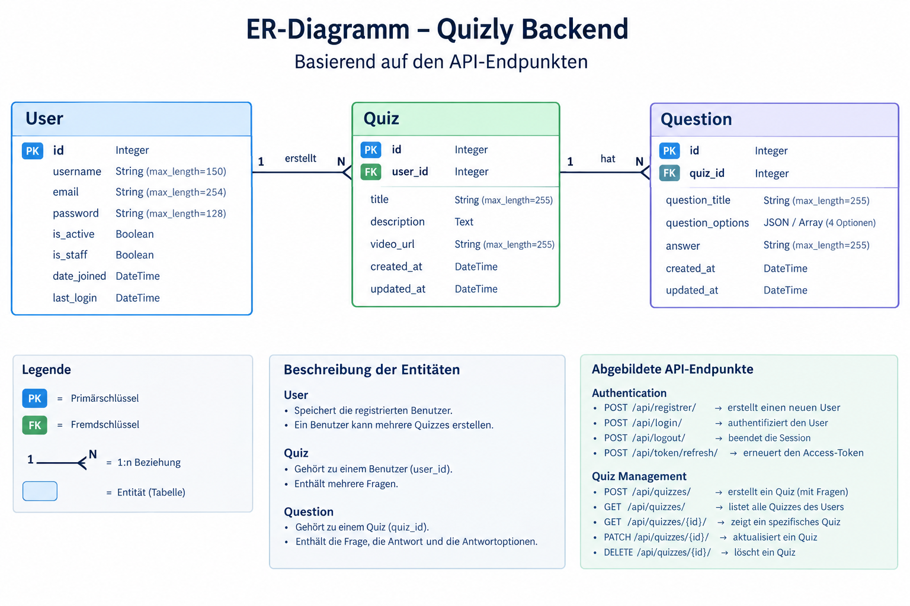

# Quizly Backend

Django REST API für die Quizly-Anwendung. Das Backend verwaltet Benutzer, Authentifizierung, Quizze und Fragen.

## Inhaltsverzeichnis

- [Technologien](#technologien)
- [Projektstruktur](#projektstruktur)
- [Datenbankmodell](#datenbankmodell)
- [API-Endpunkte](#api-endpunkte)
- [Installation und Start](#installation-und-start)
- [Tests](#tests)
- [Git-Commit-Konventionen](#git-commit-konventionen)

## Technologien

- Python
- Django
- Django REST Framework
- Simple JWT
- django-cors-headers
- pytest und pytest-django
- SQLite für die lokale Entwicklung und die In-Memory-Testdatenbank

## Projektstruktur

```text
backend/
├── core/
│   ├── settings.py
│   ├── test_settings.py
│   ├── urls.py
│   ├── asgi.py
│   └── wsgi.py
├── users/
│   ├── migrations/
│   ├── tests/
│   ├── models.py
│   └── views.py
├── quizzes/
│   ├── migrations/
│   ├── tests/
│   ├── models.py
│   └── views.py
├── manage.py
├── pytest.ini
├── requirements.txt
└── .gitignore
```

## Datenbankmodell

Das Datenmodell besteht aus drei Entitäten:

### User

Verwaltet registrierte Benutzer. Django speichert Passwörter nicht im Klartext, sondern als Passwort-Hashes.

Wichtige Felder:

- `id` – Primärschlüssel
- `username` – Benutzername
- `email` – E-Mail-Adresse
- `password` – gehashter Passwortwert
- `is_active` – Status des Benutzerkontos
- `is_staff` – Kennzeichnung für den Django-Admin
- `date_joined` – Registrierungszeitpunkt
- `last_login` – letzter Login

Das Projekt verwendet das eingebaute Django-User-Modell.

### Quiz

Ein Quiz gehört zu genau einem Benutzer. Ein Benutzer kann mehrere Quizze erstellen.

- `id` – Primärschlüssel
- `user_id` – Fremdschlüssel zum User
- `title` – Titel des Quiz
- `description` – Beschreibung
- `video_url` – URL des zugehörigen Videos
- `created_at` – Erstellungszeitpunkt
- `updated_at` – Zeitpunkt der letzten Änderung

### Question

Eine Frage gehört zu genau einem Quiz. Ein Quiz kann mehrere Fragen enthalten.

- `id` – Primärschlüssel
- `quiz_id` – Fremdschlüssel zum Quiz
- `question_title` – Fragetext
- `question_options` – vier Antwortoptionen
- `answer` – richtige Antwort
- `created_at` – Erstellungszeitpunkt
- `updated_at` – Zeitpunkt der letzten Änderung

Die Antwortoptionen können als JSON-Array gespeichert werden.

### ER-Diagramm

Das Diagramm veranschaulicht die Beziehungen zwischen User, Quiz und Question.

**Beziehungen:**

- User `1:n` Quiz
- Quiz `1:n` Question

Die Bilddatei wird im Repository unter `docs/er-diagram.png` abgelegt.



## API-Endpunkte

Basis-URL der lokalen Entwicklung:

`http://127.0.0.1:8000`

Die folgenden Endpunkte entsprechen der vorgesehenen API-Spezifikation. Nicht fertig implementierte Endpunkte werden im Laufe der Entwicklung ergänzt.

### Authentifizierung

| Methode | Endpunkt | Beschreibung | Authentifizierung |
|---|---|---|---|
| POST | `/api/register/` | Benutzer registrieren | Nein |
| POST | `/api/login/` | Benutzer anmelden | Nein |
| POST | `/api/logout/` | Benutzer abmelden und Refresh-Token invalidieren | Ja |
| POST | `/api/token/refresh/` | Access-Token erneuern | Refresh-Token-Cookie |

#### Registrierung

`POST /api/register/`

Request:

```json
{
  "username": "your_username",
  "password": "your_password",
  "confirmed_password": "your_password",
  "email": "your_email@example.com"
}
```

Erfolgreiche Antwort: `201 Created`

```json
{
  "detail": "User created successfully!"
}
```

#### Login

`POST /api/login/`

Request:

```json
{
  "username": "your_username",
  "password": "your_password"
}
```

Erfolgreiche Antwort: `200 OK`

```json
{
  "detail": "Login successfully!",
  "user": {
    "id": 1,
    "username": "your_username",
    "email": "your_email@example.com"
  }
}
```

Access- und Refresh-Token werden als Cookies gesetzt.

#### Logout

`POST /api/logout/`

Beendet die authentifizierte Sitzung, entfernt die Token-Cookies und invalidiert das Refresh-Token.

Erfolgreiche Antwort: `200 OK`

```json
{
  "detail": "Log-Out successfully! All Tokens will be deleted. Refresh token is now invalid."
}
```

#### Token erneuern

`POST /api/token/refresh/`

Benötigt ein gültiges `refresh_token`-Cookie.

Erfolgreiche Antwort: `200 OK`

```json
{
  "detail": "Token refreshed"
}
```

### Quiz-Verwaltung

Alle Quiz-Endpunkte erfordern eine Authentifizierung. Benutzer dürfen nur auf ihre eigenen Quizze zugreifen.

| Methode | Endpunkt | Beschreibung |
|---|---|---|
| POST | `/api/quizzes/` | Quiz anhand einer Video-URL erstellen |
| GET | `/api/quizzes/` | Eigene Quizze auflisten |
| GET | `/api/quizzes/{id}/` | Einzelnes eigenes Quiz abrufen |
| PATCH | `/api/quizzes/{id}/` | Quiz teilweise aktualisieren |
| DELETE | `/api/quizzes/{id}/` | Quiz und zugehörige Fragen löschen |

#### Quiz erstellen

`POST /api/quizzes/`

```json
{
  "url": "https://www.youtube.com/watch?v=example"
}
```

Bei Erfolg wird `201 Created` mit dem Quiz und seinen Fragen zurückgegeben.

#### Quiz abrufen

`GET /api/quizzes/{id}/`

Liefert das angeforderte Quiz einschließlich der zugehörigen Fragen. Fremde Quizze sollen nicht offengelegt werden.

#### Quiz aktualisieren

`PATCH /api/quizzes/{id}/`

Aktualisiert unterstützte Felder, beispielsweise `title` oder `description`.

#### Quiz löschen

`DELETE /api/quizzes/{id}/`

Löscht das Quiz und seine zugehörigen Fragen. Bei Erfolg wird `204 No Content` zurückgegeben.

## Installation und Start

### Voraussetzungen

- Python in einer unterstützten Version
- Git
- pip

### 1. Repository klonen

```bash
git clone https://github.com/Frank-Meck/Quizly-Backend.git
cd Quizly-Backend
```

### 2. Virtuelle Umgebung erstellen

Windows PowerShell:

```powershell
py -m venv .venv
.\.venv\Scripts\Activate.ps1
```

### 3. Abhängigkeiten installieren

```powershell
python -m pip install -r requirements.txt
```

### 4. Datenbank vorbereiten

```powershell
python manage.py migrate
```

### 5. Entwicklungsserver starten

```powershell
python manage.py runserver
```

Die API ist anschließend unter `http://127.0.0.1:8000/` erreichbar.

## Tests

Die Tests werden mit pytest und pytest-django ausgeführt. Für Tests wird `core.test_settings` verwendet. Diese Konfiguration nutzt eine In-Memory-SQLite-Datenbank und einen schnellen Passwort-Hasher.

Alle Tests ausführen:

```powershell
python -m pytest
```

Einzelnen Test ausführen:

```powershell
python -m pytest users/tests/test_register.py
```

Die Testeinstellungen sind in `pytest.ini` konfiguriert.

## Git-Commit-Konventionen

Commit-Nachrichten folgen dem Schema:

`type: short description`

| Typ | Verwendung |
|---|---|
| `feat` | Neue Funktionalität |
| `fix` | Fehlerbehebung |
| `docs` | Dokumentation |
| `style` | Reine Formatierung |
| `refactor` | Code-Umstrukturierung |
| `perf` | Performance-Optimierung |
| `test` | Tests |
| `chore` | Wartung und Konfiguration |
| `build` | Build-System und Abhängigkeiten |
| `ci` | CI/CD-Pipelines |
| `revert` | Frühere Änderungen zurücknehmen |

Beispiele:

```text
feat: add user registration endpoint
test: add registration endpoint tests
fix: validate login credentials
docs: update API documentation
chore: update gitignore
```

## Entwicklungsstatus

Quizly Backend wird schrittweise testgetrieben entwickelt (TDD). Zuerst werden Tests geschrieben, danach die zugehörigen Funktionen implementiert und anschließend erneut getestet.

Die tatsächliche Implementierung kann vom hier dokumentierten Zielzustand abweichen, solange sich das Projekt in Entwicklung befindet.